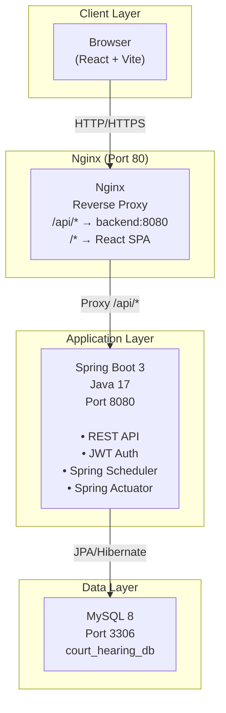
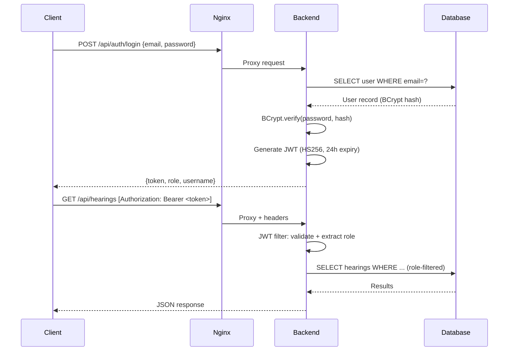
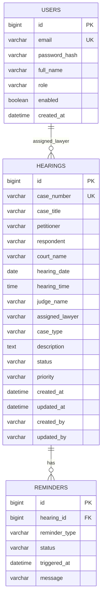

# Architecture — Automated Court Hearing Reminder Portal

## System Architecture



## CI/CD Pipeline Architecture

```mermaid
graph LR
    subgraph "Source Control"
        GitHub["GitHub\nRepository"]
    end

    subgraph "CI Server"
        Jenkins["Jenkins\n(Docker)\nJenkinsfile"]
        Maven["Maven Build\n+ Unit Tests"]
        Selenium["Selenium\nTests"]
        DockerBuild["Docker\nBuild"]
    end

    subgraph "Registry"
        DockerHub["Docker Hub\nVersioned Images\n1.0.0 / 1.0.1"]
    end

    subgraph "Deployment"
        Ansible["Ansible\nPlaybook\n(Linux/WSL)"]
        Deploy["Deploy Server\ndocker compose up"]
        Health["Health Check\n/api/health"]
        Rollback["Rollback\nPrevious Tag"]
    end

    GitHub -->|"Webhook / Poll"| Jenkins
    Jenkins --> Maven
    Maven -->|"Pass"| Selenium
    Selenium -->|"Pass"| DockerBuild
    DockerBuild -->|"Push"| DockerHub
    DockerHub --> Ansible
    Ansible --> Deploy
    Deploy --> Health
    Health -->|"Fail"| Rollback
    Health -->|"Pass"| Deploy
```



## Component Diagram

```mermaid
graph TB
    subgraph "Frontend (React)"
        LP[Login Page]
        DP[Dashboard]
        HL[Hearing List]
        AH[Add/Edit Hearing]
        HD[Hearing Details]
        RP[Reminders Page]
    end

    subgraph "Backend API"
        AC[AuthController\nPOST /api/auth/login]
        HC[HearingController\nGET/POST/PUT/DELETE /api/hearings]
        SC[SearchController\nGET /api/hearings/search]
        DC[DashboardController\nGET /api/dashboard/summary]
        RC[ReminderController\nGET /api/reminders/upcoming]
        HH[HealthController\nGET /api/health]
    end

    subgraph "Service Layer"
        AS[AuthService]
        HS[HearingService]
        RS[ReminderService]
        DS[DashboardService]
        JS[JWT Service]
        Sched[ReminderScheduler\n@Scheduled every hour]
    end

    subgraph "Data Layer"
        UR[UserRepository]
        HR[HearingRepository]
        RR[ReminderRepository]
        UE[User Entity]
        HE[Hearing Entity]
        RE[Reminder Entity]
    end

    LP --> AC
    DP --> DC
    HL --> HC
    AH --> HC
    HD --> HC
    RP --> RC

    AC --> AS
    HC --> HS
    DC --> DS
    RC --> RS
    AS --> JS
    AS --> UR
    HS --> HR
    DS --> HR
    RS --> RR
    Sched --> RS

    UR --> UE
    HR --> HE
    RR --> RE
```

## Technology Stack

| Layer | Technology | Version |
|-------|-----------|---------|
| Language | Java | 17 |
| Framework | Spring Boot | 3.x |
| ORM | Spring Data JPA / Hibernate | 3.x |
| Security | Spring Security + JWT | 6.x |
| Build | Maven | 3.9+ |
| Database | MySQL | 8.0 |
| Test DB | H2 (unit tests only) | 2.x |
| Unit Tests | JUnit 5 + Mockito | 5.x |
| E2E Tests | Selenium WebDriver | 4.x |
| Frontend | React + Vite | 18/5 |
| HTTP Client | Axios | 1.x |
| Containerization | Docker + Docker Compose | 29.x |
| CI | Jenkins | LTS |
| Config Mgmt | Ansible | 2.15+ |
| Web Server | Nginx | 1.25 |
| SCM | Git + GitHub | 2.x |

## Security Architecture



## Data Model


